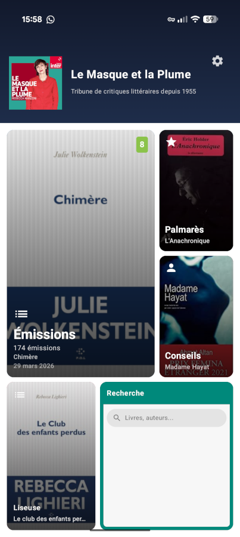

# lmelp-mobile


Application Android pour consulter le contenu de Le Masque et la Plume (LMELP) — émission littéraire de France Inter — hors connexion.

Et obtenir des recommandations de lectures personnalisées.



## Projets associés

Les projets associés sont :

- **[lmelp](https://github.com/castorfou/lmelp)** - pour telecharger les episodes radiophoniques (podcasts) du masque
- **[back-office-lmelp](https://github.com/castorfou/back-office-lmelp)** - pour travailler le contenu de la base de données.
- **[docker-lmelp](https://github.com/castorfou/docker-lmelp)** - pour héberger l'ensemble des composants dans une stack docker.
- **[lmelp-pap](https://github.com/castorfou/lmelp-pap)** - le Projet d'Archivage Patrimoniale (1955-2016) des épisodes du Masque et la Plume.

Tous ces projets sont basés sur le template de projet [PyFoundry](https://castorfou.github.io/PyFoundry/).


## Vision

Application mobile **standalone et offline-first** permettant de consulter :
- Les émissions avec leurs critiques et avis
- Le palmarès des livres
- La liste des critiques et leurs avis
- La recherche dans toute la base
- Les recommandations personnalisées (collaborative filtering SVD)

L'application et ses données sont publiées séparément sur les GitHub Releases du dépôt :

- **les données** (base SQLite) sur la release `data-v{N}`, publiée automatiquement toutes les heures par le NAS quand le contenu change ; l'app la télécharge depuis son écran À propos ;
- **l'appli** (APK signé) sur une release `vX.Y.Z`, publiée quand on pousse le tag correspondant.

## Architecture

```
back-office-lmelp (MongoDB)
        │
        ▼
scripts/export_mongo_to_sqlite.py
        │
        ▼
lmelp.db  (SQLite snapshot, container lmelp-export sur le NAS)
        │
        ▼  release GitHub data-v{N}, toutes les heures si le contenu change
Application Android (Kotlin + Jetpack Compose + Room)
        ▲
        │  release GitHub vX.Y.Z (APK signé par release.yml sur tag)
code Kotlin
```

## Stack technique

| Composant      | Technologie                     |
| -------------- | ------------------------------- |
| Langage        | Kotlin                          |
| UI             | Jetpack Compose                 |
| ORM            | Room (SQLite)                   |
| Navigation     | Navigation Compose              |
| Build          | Gradle (Kotlin DSL)             |
| CI/CD          | GitHub Actions                  |
| Distribution   | GitHub Releases                 |
| Export données | Python 3.11+ (pymongo → SQLite) |

## Fonctionnalités cibles

### V1 — Consultation offline

| Écran               | Description                                                                      |
| ------------------- | -------------------------------------------------------------------------------- |
| **Émissions**       | Liste des émissions avec date, durée, statut                                     |
| **Détail émission** | Livres discutés, critiques présents, avis par livre                              |
| **Palmarès**        | Livres classés par note moyenne décroissante                                     |
| **Critiques**       | Liste des 25 critiques avec leurs avis                                           |
| **Détail critique** | Tous les avis d'un critique avec notes                                           |
| **Recherche**       | Full-text search sur titres, auteurs, critiques                                  |
| **Recommandations** | Livres recommandés par collaborative filtering SVD                               |
| **Sur ma liseuse**  | Livres Calibre tagués `onkindle`, filtrés par virtual library, avec notes Masque |

### V2 — Mise à jour sans câble

- Données : téléchargement de la release `data-v{N}` depuis l'écran À propos
- Appli : APK signé publié sur une release `vX.Y.Z`, installé depuis le téléphone

## Développer, livrer, mettre à jour

| | Commande | Résultat |
|---|---|---|
| Tester une modification | `scripts/build.sh && scripts/deploy.sh` | APK debug installé en USB |
| Publier une version de l'appli | `git tag vX.Y.Z && git push origin vX.Y.Z` | APK signé sur la release GitHub `vX.Y.Z` |
| Mettre à jour l'appli (utilisateur) | télécharger l'APK de la dernière release `vX.Y.Z` | mise à jour sans perte des données |
| Mettre à jour les données (utilisateur) | À propos → mise à jour | nouvelle base téléchargée |

APK debug et APK release n'ont pas la même signature : passer de l'un à l'autre impose de désinstaller l'app. Le cycle complet, la signature et le keystore de release sont décrits dans [Développer, livrer, mettre à jour](https://castorfou.github.io/lmelp-mobile/dev/livrer_appli/).

## Setup développement

### Prérequis

- Android Studio Hedgehog ou supérieur
- JDK 17+
- Python 3.11+ avec `uv` (pour le script d'export)
- Accès à une instance MongoDB `masque_et_la_plume`

### Générer la base SQLite

```bash
# Installer les dépendances Python
uv pip install -e .

# Configurer l'environnement local (une seule fois)
cp scripts/.env.example scripts/.env
# Éditer scripts/.env avec mongo URI, chemin Calibre, virtual library
# (LMELP_CALIBRE_DB pointe sur metadata.db, dans le dossier complet de la
# bibliothèque : l'export y lit aussi les cover.jpg des livres)

# Exporter MongoDB → SQLite (base complète locale, hors du dépôt)
python scripts/export_mongo_to_sqlite.py --force --output /tmp/lmelp_complete.db

# Vérifier le résultat
python scripts/export_mongo_to_sqlite.py --verify /tmp/lmelp_complete.db
```

L'APK n'embarque qu'un extrait minimal (`app/src/main/assets/lmelp.db`), régénéré avec `scripts/build_mini_db.py` : ne jamais y exporter la base complète (voir [Build / Deploy apk](https://castorfou.github.io/lmelp-mobile/dev/build_deploy_apk/#regenerer-la-db-asset)).
### Lancer l'appli

```bash
# Ouvrir le projet dans Android Studio
# ou build en ligne de commande + installation en USB :
scripts/build.sh && scripts/deploy.sh
```


## Source des données

Les données proviennent du projet [back-office-lmelp](https://github.com/castorfou/back-office-lmelp) :
- **227 émissions** de Le Masque et la Plume
- **1615 livres** discutés
- **1114 auteurs**
- **25 critiques**
- **4100+ avis** avec notes (1-10)
