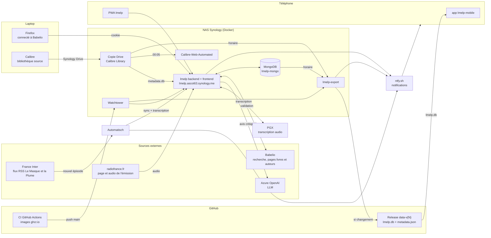

# Écosystème lmelp

Vue d'ensemble des briques qui alimentent l'application lmelp-mobile : qui alimente qui, et **ce qui déclenche chaque flux**. Les détails propres à chaque brique sont dans la documentation de [back-office-lmelp](https://castorfou.github.io/back-office-lmelp/) et de [docker-lmelp](https://castorfou.github.io/docker-lmelp/) ; le parcours d'un nouvel épisode, pas à pas, est dans [Mise à jour d'un épisode](user/mise_a_jour_episode.md).

## Schéma synoptique

## Déclencheurs

Le schéma ne garde que des étiquettes courtes ; le détail de chaque flux est ici.

| Flux | Déclencheur |
|---|---|
| RSS → Automatisch → back-office (`POST /api/rss/sync` puis `/api/pgx/transcription/start`) | publication d'un nouvel épisode dans le flux RSS |
| Ajout d'une émission absente du RSS | manuel, page **Ajouter une émission** |
| Transcription PGX (ssh/scp : envoi de l'audio, retour de la transcription) | lancée par Automatisch ou à la main ; réessai **toutes les heures** si PGX est injoignable |
| Avis critiques (LLM) | manuel, page **Génération Avis Critiques** |
| Babelio (Valider avec Babelio, Liaison Babelio, couvertures) | manuel uniquement (aucune requête à l'ouverture des pages), 1 requête par `BABELIO_FAIR_SEC`, empreinte Firefox ; cookie copié depuis Firefox **connecté** à Babelio, valable ~5 min |
| Calibre laptop → copie Drive | **continu** (Synology Drive, quelques secondes) |
| Copie Drive → back-office | lecture seule, relue dès que `metadata.db` change |
| Copie Drive → Calibre-Web-Automated | **chaque nuit à 00:05** (CWA seulement) |
| MongoDB + Calibre (livres lus) → `lmelp-export` → release `data-v{N}` | **toutes les heures** (`PUBLISH_INTERVAL`), publication seulement si le contenu a changé (la release est alors republiée sur place) ; immédiat avec `docker exec lmelp-export export-and-publish-release` |
| Release → app mobile | détection au lancement de l'app (point vert) ; téléchargement **manuel** (À propos → Vérifier les mises à jour) |
| Nouvelle version de code | push sur `main` → CI → images ghcr.io → Watchtower recrée les conteneurs (back-office, `lmelp-export`) |
| Notifications ntfy | Automatisch : nouvel épisode ; back-office : chaque étape traitée ; `lmelp-export` : nouvelles données publiées, premier échec, puis rétablissement |
| Sauvegarde MongoDB | **hebdomadaire** (anacron dans `lmelp-mongo`) |

!!! note "La release `data-v{N}` est republiée sur place"
    `N` est la version du schéma de la base, pas un numéro de publication : la date réelle de la dernière publication est `export_datetime` dans `metadata.json`, pas la date de la release. Détails dans [Mise à jour d'un épisode](user/mise_a_jour_episode.md#mettre-a-jour-la-base-depuis-lapplication).
