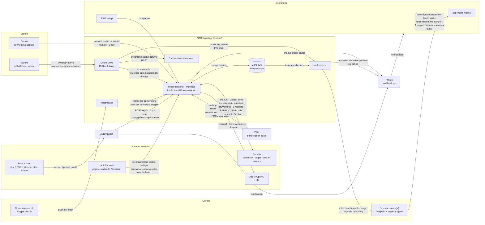

# Écosystème lmelp

Vue d'ensemble des briques qui alimentent l'application lmelp-mobile : qui alimente qui, et **ce qui déclenche chaque flux**. Les détails propres à chaque brique sont dans la documentation de [back-office-lmelp](https://castorfou.github.io/back-office-lmelp/) et de docker-lmelp ; le parcours d'un nouvel épisode, pas à pas, est dans [Mise à jour d'un épisode](user/mise_a_jour_episode.md).

## Schéma synoptique

## Déclencheurs

| Flux | Déclencheur |
|---|---|
| RSS → Automatisch → back-office (téléchargement audio, transcription) | publication d'un nouvel épisode dans le flux RSS |
| Ajout d'une émission absente du RSS | manuel, page **Ajouter une émission** |
| Transcription PGX | lancée par Automatisch ou à la main ; réessai **toutes les heures** si PGX est injoignable |
| Avis critiques (LLM) | manuel, page **Génération Avis Critiques** |
| Babelio | manuel uniquement (aucune requête à l'ouverture des pages) ; cookie copié depuis Firefox **connecté** à Babelio, valable ~5 min |
| Calibre laptop → copie Drive | **continu** (Synology Drive, quelques secondes) |
| Copie Drive → back-office | lecture directe, relue dès que `metadata.db` change |
| Copie Drive → Calibre-Web-Automated | **chaque nuit à 00:05** (CWA seulement) |
| MongoDB + Calibre → `lmelp-export` → release `data-v{N}` | **toutes les heures** (`PUBLISH_INTERVAL`), publication seulement si le contenu a changé ; immédiat avec `docker exec lmelp-export export-and-publish-release` |
| Release → app mobile | détection au lancement de l'app ; téléchargement **manuel** (À propos → Vérifier les mises à jour) |
| Nouvelle version de code | push sur `main` → CI → images ghcr.io → Watchtower recrée les conteneurs |
| Sauvegarde MongoDB | **hebdomadaire** (anacron dans `lmelp-mongo`) |

!!! note "La release `data-v{N}` est republiée sur place"
    `N` est la version du schéma de la base (`PRAGMA user_version`, version Room), pas un numéro de publication. Chaque export qui publie remplace les fichiers de la même release `data-v{N}` ; le numéro ne change que lorsque le schéma change (voir [ADR 0001](dev/adr/0001-separation-maj-appli-donnees.md)). La date affichée par GitHub pour la release reste donc celle de sa création : la date réelle de la dernière publication est `export_datetime` dans `metadata.json`.
